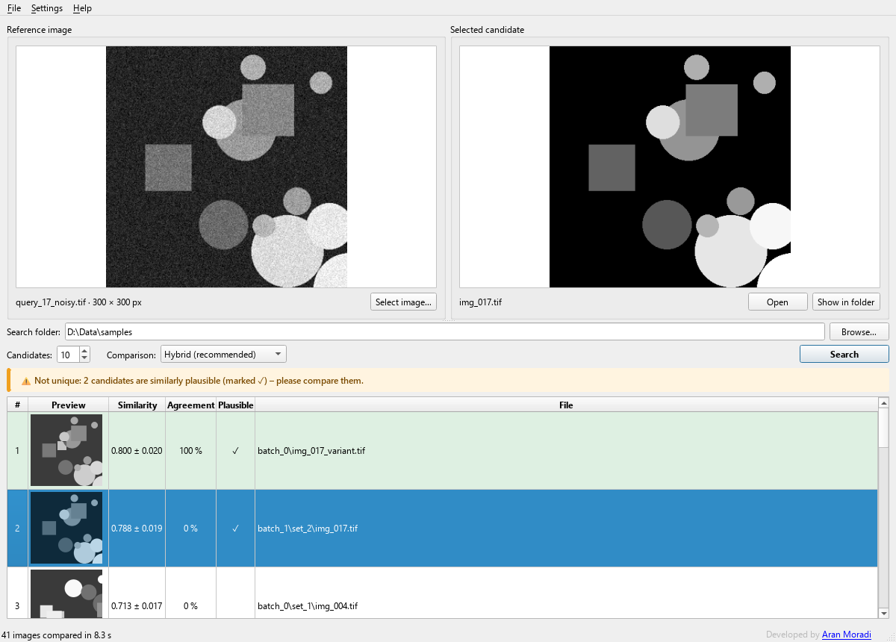

# ObjectTwin

ObjectTwin finds the image in a (nested) folder structure that **looks most similar**
to a reference image. It is built on Meta AI's self-supervised vision model
[DINOv2](https://github.com/facebookresearch/dinov2).

**Repository:** <https://github.com/27aran/ObjectTwin> · **Developer:**
[Aran Moradi](https://www.linkedin.com/in/aran-moradi-963330370/)

The end product is a standalone Windows application (`ObjectTwin.exe`) with a simple
user interface:

1. Select a reference image (TIFF is fully supported, as well as PNG, JPEG, BMP, …)
2. Check the preview
3. Select a search folder – all subfolders are searched recursively
4. Start the search → list of candidates, ranked by similarity, with a confidence
   verdict (*confident* / *ambiguous – compare the alternatives* / *no good match*)



## Status

| Step | Content                                      | State   |
|------|----------------------------------------------|---------|
| 1    | Project scaffold, tooling, docs              | ✅      |
| 2    | Image loading incl. TIFF                     | ✅      |
| 3    | DINOv2 embeddings & similarity search        | ✅      |
| 4    | Confidence estimation (uncertainty)          | ✅      |
| 5    | GUI (selection, preview, search, results)    | ✅      |
| 6    | Build as `.exe` (PyInstaller)                | ✅      |
| 7    | User & developer documentation               | ✅      |

## Documentation

| Document | For |
|----------|-----|
| [User guide](docs/user-guide.md) · [Benutzerhandbuch](docs/user-guide.de.md) | end users |
| [Architecture](docs/architecture.md) | developers – design, algorithms, confidence estimation |
| [Building the exe](docs/building.md) | developers – packaging and distribution |
| [Third-party licenses](docs/third-party-licenses.md) | distribution |
| [Changelog](CHANGELOG.md) | everyone |

## Using the application

Unzip `ObjectTwin-cu126.zip` (or `-cpu`) anywhere and start `ObjectTwin.exe` – no
installation, no Python, works offline. From source: `uv run objecttwin`.

1. **Reference image** – *Select image…* (or drag & drop a file onto the window).
   A preview and the image size are shown.
2. **Search folder** – *Browse…* (or drop a folder onto the window). All subfolders are
   searched.
3. Optionally set the number of **candidates** and the **comparison** mode
   (*Hybrid* is recommended, see [Descriptors](docs/architecture.md#descriptors)).
4. **Search.** Progress is shown; the search can be cancelled at any time.
5. The coloured banner gives the **verdict**:
   * green – clear match,
   * amber – several candidates are plausible (marked ✓ and tinted green) – compare them,
   * red – no candidate stands out; the image may not be in the folder.
6. Click a row to compare the candidate side by side with the reference image;
   double-click (or *Open*) opens the file, *Show in folder* reveals it in Explorer.

Columns: *Similarity* = mean cosine similarity ± its standard deviation over the query
variants; *Agreement* = share of query variants for which the image ranked first;
*Plausible* = not significantly worse than the best match.

Language (English / German) can be switched under *Settings → Language*; it and the
last image, folder and options are remembered. The model is loaded in the background
right after start (the status bar shows when it is ready and whether it runs on the GPU
or the CPU). Logs are written to `%LOCALAPPDATA%\ObjectTwin\logs` (*Help → Open log
folder*).

## Development

Requirements: Windows 10/11, [uv](https://docs.astral.sh/uv/) (installs Python 3.11 on demand).

```powershell
git clone https://github.com/27aran/ObjectTwin.git
cd ObjectTwin
uv sync --extra cpu      # create virtual environment + install dependencies (CPU PyTorch)
uv run pytest            # fast tests incl. headless GUI tests (no model download)
uv run pytest -m model   # tests with the real DINOv2 model (downloads weights once)
uv run ruff check        # linting
uv run ruff format       # formatting
uv run objecttwin        # start the application
```

PyTorch is installed as one of two mutually exclusive extras:

| Extra   | Command                    | Use                                                   |
|---------|----------------------------|-------------------------------------------------------|
| `cpu`   | `uv sync --extra cpu`      | development, machines without NVIDIA GPU (small)      |
| `cu126` | `uv sync --extra cu126`    | NVIDIA GPU via CUDA 12.6 (large, ~2.5 GB)             |

The application always picks the GPU automatically when one is available and falls back
to the CPU otherwise.

### Command line

The search can also be run without the GUI:

```powershell
uv run python -m objecttwin.cli path\to\query.tif path\to\folder --top 5
```

Example output:

```
Verdict: AMBIGUOUS  (plausible candidates: 2, margin: 0.0127, z: 4.8, query variants: 9)
rank   score   ± std  votes  path
  1*  0.8004 ±0.0199   100%  data\batch_0\img_017_variant.tif
  2*  0.7877 ±0.0193     0%  data\batch_1\set_2\img_017.tif
  3   0.7126 ±0.0167     0%  data\batch_0\set_1\img_004.tif
(* = plausible: not significantly worse than the best match)
```

| Option          | Meaning                                                                     |
|-----------------|-----------------------------------------------------------------------------|
| `--top N`       | number of candidates to list (default 10)                                   |
| `--descriptor`  | `hybrid` (default), `global` or `spatial` – see [architecture](docs/architecture.md#descriptors) |
| `--no-augment`  | skip query augmentation (faster, no stability / vote estimates)             |
| `--model`       | Hugging Face name or local folder (default `facebook/dinov2-base`)          |
| `--device`      | `cuda` or `cpu` (default: automatic)                                        |
| `-v`            | debug logging                                                               |

## Building the executable

```powershell
python scripts/build_exe.py --zip        # GPU build (CUDA 12.6), falls back to CPU
python scripts/build_exe.py --cpu --zip  # CPU-only build (smaller)
```

The result is `dist\<variant>\ObjectTwin\ObjectTwin.exe` (+ zip). The build uses its own
virtual environment, bundles the model weights and finishes with an automatic
`ObjectTwin.exe --self-test`. Details: [docs/building.md](docs/building.md).

## Project structure

```
ObjectTwin/
├── src/objecttwin/   # application code (package)
│   ├── gui/          #   PySide6 user interface
│   └── assets/       #   application icon
├── tests/            # pytest tests (incl. headless GUI tests)
├── scripts/          # build_exe.py, download_model.py, make_icon.py
├── packaging/        # PyInstaller spec + launcher
├── docs/             # architecture & build documentation
├── pyproject.toml    # metadata, dependencies, tool configuration
└── README.md
```

## License

ObjectTwin is released under the [MIT License](LICENSE). The executable bundles
third-party components under their own licenses – see
[docs/third-party-licenses.md](docs/third-party-licenses.md).

Architecture details: [docs/architecture.md](docs/architecture.md) · Building: [docs/building.md](docs/building.md)
