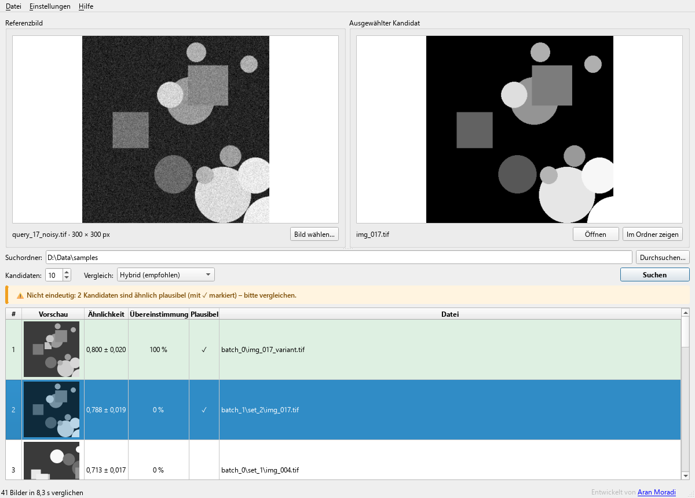

# ObjectTwin – Benutzerhandbuch

*[English version](user-guide.md)*

ObjectTwin findet in einem Ordner (einschließlich aller Unterordner) die Bilder, die
einem Referenzbild am ähnlichsten sehen. Das Programm arbeitet vollständig offline auf
Ihrem Computer – Ihre Bilder werden nur gelesen, niemals verändert, hochgeladen oder
kopiert.



## 1. Installation

1. `ObjectTwin-cu126.zip` in einen beliebigen Ordner entpacken, z. B. `C:\Tools\ObjectTwin`.
   Den Ordner zusammenlassen – `ObjectTwin.exe` benötigt den Ordner `_internal` daneben.
2. `ObjectTwin.exe` doppelklicken. Keine Installation und keine Administratorrechte nötig.

Das Fenster öffnet sofort; das Bildmodell wird im Hintergrund geladen. Die Statusleiste
unten zeigt *Bereit – Modell läuft auf …*, sobald es bereit ist – und ob die
**Grafikkarte** (z. B. *Quadro RTX 4000 (CUDA)*) oder die **CPU** verwendet wird.
Der allererste Start nach dem Entpacken kann etwa eine Minute dauern, weil Windows die
neuen Dateien prüft; danach startet das Programm deutlich schneller.

## 2. Ähnliche Bilder finden

| Schritt | Vorgehen |
|---------|----------|
| **1. Referenzbild** | **Bild wählen…** klicken (oder eine Bilddatei auf das Fenster ziehen). TIFF wird vollständig unterstützt – auch 16 bit, 32-bit-Gleitkomma, Graustufen und mehrseitige Dateien – außerdem PNG, JPEG, BMP, GIF und WebP. Vorschau, Dateiname und Bildgröße werden angezeigt. |
| **2. Suchordner** | **Durchsuchen…** neben *Suchordner* klicken (oder einen Ordner auf das Fenster ziehen). Alle Unterordner werden mit durchsucht. |
| **3. Optionen** (optional) | **Kandidaten**: wie viele Ergebnisse angezeigt werden (Standard 10). **Vergleich**: siehe [Abschnitt 4](#4-vergleichsmodus-wählen). |
| **4. Suchen** | **Suchen** klicken (oder Enter im Ordnerfeld). Ein Fortschrittsbalken zeigt, wie viele Bilder schon verglichen wurden; **Abbrechen** beendet die Suche jederzeit. |

## 3. Ergebnisse verstehen

### Das Ergebnis-Banner

Das farbige Banner über der Ergebnisliste zeigt, wie verlässlich das Ergebnis ist:

| Banner | Bedeutung | Vorgehen |
|--------|-----------|----------|
|  | Ein Bild hebt sich deutlich ab. | In der Regel ist das der gesuchte Treffer – eine kurze Sichtprüfung genügt. |
|  | Mehrere Bilder sind etwa gleich wahrscheinlich. Sie sind mit ✓ markiert und grün hinterlegt. | Alle markierten Kandidaten mit dem Referenzbild vergleichen. |
|  | Kein Bild hebt sich von den übrigen ab. | Das Bild ist vermutlich nicht in diesem Ordner. Die ersten Kandidaten sorgfältig prüfen oder einen anderen Ordner durchsuchen. |

ObjectTwin zeigt bewusst **mehrere Kandidaten** – das Modell kann sich irren, und das
Banner sagt Ihnen, wann es unsicher ist.

### Die Ergebnisliste

| Spalte | Bedeutung |
|--------|-----------|
| **#** | Rang – 1 ist das ähnlichste Bild. |
| **Vorschau** | Miniaturansicht des Bildes. |
| **Ähnlichkeit** | Wie ähnlich das Bild dem Referenzbild ist (1,000 = identisch). Der Wert nach ± zeigt, wie stabil dieser Wert ist. Werte *innerhalb einer Suche* vergleichen – die absolute Zahl hängt von der Art der Bilder ab. |
| **Übereinstimmung** | ObjectTwin prüft das Referenzbild mehrfach in leicht veränderten Varianten (kleine Verschiebung, Drehung, Helligkeit …). Die Spalte zeigt, wie oft das Bild dabei auf Platz 1 lag. 100 % = es hat jedes Mal gewonnen. |
| **Plausibel** | ✓ = nicht signifikant schlechter als der beste Treffer – sollte angesehen werden. |
| **Datei** | Pfad relativ zum Suchordner. Mit der Maus darüberfahren zeigt den vollständigen Pfad. |

**Klick** auf eine Zeile zeigt den Kandidaten groß neben dem Referenzbild.
**Doppelklick** (oder **Öffnen**) öffnet die Datei im Standard-Bildbetrachter;
**Im Ordner zeigen** öffnet den Windows-Explorer mit markierter Datei.

Konnten einzelne Dateien nicht gelesen werden (z. B. beschädigte Dateien), erscheint unter
der Liste ein Link *N Datei(en) übersprungen…* – ein Klick zeigt, welche und warum. Die
Suche selbst läuft weiter.

## 4. Vergleichsmodus wählen

| Modus | Geeignet für |
|-------|--------------|
| **Hybrid (empfohlen)** | Fast alle Fälle. Kombiniert die beiden folgenden Verfahren. |
| **Global – robust gegen Lage** | Wenn das Objekt in den Bildern an sehr unterschiedlichen Positionen, in unterschiedlicher Größe oder unter anderem Winkel vorkommt. |
| **Räumlich – feine Details** | Wenn alle Bilder ähnlich aussehen (gleiche Objektart, gleicher Aufbau) und sich vor allem in feinen Details oder der genauen Anordnung unterscheiden. |

Im Zweifel *Hybrid* lassen. Ist das Ergebnis *nicht eindeutig* oder *kein Treffer*,
obwohl ein Treffer erwartet wird, lohnt sich ein Versuch mit den anderen Modi.

## 5. Einstellungen

* **Sprache:** *Einstellungen → Sprache → English / Deutsch*. Wirkt sofort.
* *Hilfe → Über ObjectTwin* zeigt Version, Modell, verwendetes Gerät und den Entwickler;
  *Hilfe → Entwickler auf LinkedIn* öffnet das Profil des Entwicklers.
* ObjectTwin merkt sich das letzte Referenzbild, den Suchordner, die Optionen, die
  Sprache und die Fenstergröße.

## 6. Fehlerbehebung

| Problem | Lösung |
|---------|--------|
| Statusleiste zeigt *Modell läuft auf CPU*, obwohl eine NVIDIA-Grafikkarte vorhanden ist | NVIDIA-Treiber aktualisieren (Version 525 oder neuer) und ObjectTwin neu starten. Das Programm funktioniert auch auf der CPU, nur langsamer. |
| Suche ist langsam | Auf der CPU sind einige Bilder pro Sekunde normal; mit Grafikkarte ist es deutlich schneller. Große TIFF-Dateien brauchen länger zum Einlesen. |
| *Das Bild konnte nicht geladen werden* | Die Datei ist beschädigt oder kein Bild. Testweise in einem anderen Programm öffnen. |
| Sonstige Fehler | *Hilfe → Log-Ordner öffnen* öffnet den Ordner mit der Protokolldatei `objecttwin.log` – diese an den Support schicken. |

### Installation prüfen

Eine Eingabeaufforderung im ObjectTwin-Ordner öffnen und ausführen:

```
ObjectTwin.exe --self-test
```

Es öffnet sich kein Fenster. Nach etwa einer Minute liegt der Bericht unter
`%LOCALAPPDATA%\ObjectTwin\logs\selftest.txt` – er prüft Grafikkarte, Modell,
TIFF-Einlesen und Oberfläche. Die letzte Zeile sollte `RESULT: PASSED` lauten.

## 7. Datenschutz

ObjectTwin läuft vollständig auf Ihrem Computer und benötigt keine Internetverbindung.
Bilder werden ausschließlich gelesen. ObjectTwin schreibt nur seine Einstellungen
(Windows-Registry, `HKEY_CURRENT_USER\Software\ObjectTwin`) und Protokolldateien
(`%LOCALAPPDATA%\ObjectTwin\logs`).
