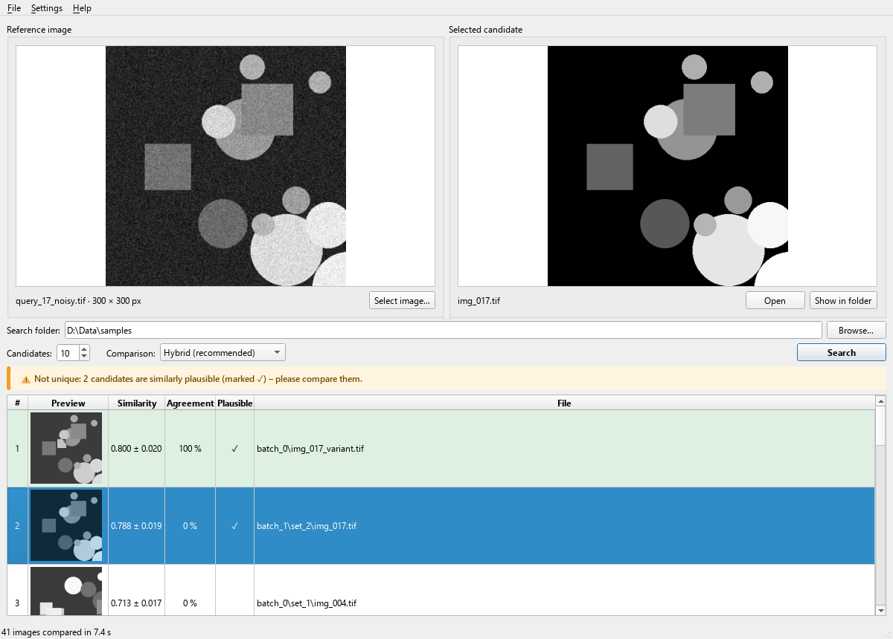

# ObjectTwin – User Guide

*[Deutsche Version](user-guide.de.md)*

ObjectTwin finds the images in a folder (including all subfolders) that look most
similar to a reference image. It works completely offline on your computer – your
images are only read, never changed, uploaded or copied.



## 1. Installation

1. Unzip `ObjectTwin-cu126.zip` to any folder, e.g. `C:\Tools\ObjectTwin`.
   Keep the folder together – `ObjectTwin.exe` needs the `_internal` folder next to it.
2. Double-click `ObjectTwin.exe`. No installation or administrator rights are needed.

The window opens immediately; the image model is loaded in the background. The status
bar at the bottom shows *Ready – model runs on …* once it is ready, including whether
the **graphics card** (e.g. *Quadro RTX 4000 (CUDA)*) or the **CPU** is used.
The very first start after unzipping can take about a minute because Windows checks the
new files; later starts are much faster.

## 2. Finding similar images

| Step | What to do |
|------|------------|
| **1. Reference image** | Click **Select image…** (or drag an image file onto the window). TIFF is fully supported – including 16-bit, 32-bit float, grayscale and multi-page files – as well as PNG, JPEG, BMP, GIF and WebP. A preview, the file name and the image size appear. |
| **2. Search folder** | Click **Browse…** next to *Search folder* (or drag a folder onto the window). All subfolders are searched as well. |
| **3. Options** (optional) | **Candidates**: how many results to list (default 10). **Comparison**: see [section 4](#4-choosing-the-comparison-mode). |
| **4. Search** | Click **Search** (or press Enter in the folder field). A progress bar shows how many images have been compared; **Cancel** stops the search at any time. |

## 3. Reading the results

### The verdict banner

The coloured banner above the result list tells you how reliable the result is:

| Banner | Meaning | What to do |
|--------|---------|------------|
|  | One image clearly stands out. | Normally this is your match – a quick visual check is enough. |
|  | Several images are about equally likely. They are marked ✓ and highlighted green. | Compare all marked candidates with the reference image. |
|  | No image stands out from the rest. | The image may not be in this folder. Check the top candidates carefully, or search a different folder. |

ObjectTwin deliberately lists **several candidates** – the model can be wrong, and the
verdict tells you when it is unsure.

### The result list

| Column | Meaning |
|--------|---------|
| **#** | Rank – 1 is the most similar image. |
| **Preview** | Thumbnail of the image. |
| **Similarity** | How similar the image is to the reference (1.000 = identical). The value after ± shows how stable this score is. Compare values *within one search* – the absolute number depends on the kind of images. |
| **Agreement** | ObjectTwin checks the reference image several times in slightly altered versions (small shifts, rotation, brightness …). This column shows how often the image came out on top. 100 % = it won every time. |
| **Plausible** | ✓ = not significantly worse than the best match – should be looked at. |
| **File** | Path relative to the search folder. Hover over it to see the full path. |

**Click** a row to show the candidate large next to the reference image.
**Double-click** (or **Open**) opens the file in your default image viewer;
**Show in folder** opens Windows Explorer with the file selected.

If some files could not be read (e.g. damaged files), a link *N file(s) skipped…* appears
below the list – click it to see which files and why. The search itself continues.

## 4. Choosing the comparison mode

| Mode | Best for |
|------|----------|
| **Hybrid (recommended)** | Almost all cases. Combines both methods below. |
| **Global – robust to position** | When the object can appear at very different positions, sizes or angles in the images. |
| **Spatial – fine detail** | When all images look alike (same kind of object, same setup) and the differences are in fine details or the exact layout. |

If you are unsure, keep *Hybrid*. If the result is *ambiguous* or *no match* although
you expect a match, it can be worth trying the other modes.

## 5. Settings

* **Language:** *Settings → Language → English / Deutsch*. Takes effect immediately.
* ObjectTwin remembers the last reference image, search folder, options, language and
  window size.

## 6. Troubleshooting

| Problem | Solution |
|---------|----------|
| Status bar says *model runs on CPU* although the computer has an NVIDIA graphics card | Update the NVIDIA driver (version 525 or newer) and restart ObjectTwin. The program also works on the CPU, only slower. |
| Search is slow | On the CPU, expect a few images per second; with the graphics card it is much faster. Large TIFF files take longer to read. |
| *The image could not be loaded* | The file is damaged or not an image. Try opening it in another program. |
| Something else goes wrong | *Help → Open log folder* opens the folder with the log file `objecttwin.log` – send it to your support contact. |

### Checking the installation

Open a command prompt in the ObjectTwin folder and run:

```
ObjectTwin.exe --self-test
```

No window opens. After about a minute the report is written to
`%LOCALAPPDATA%\ObjectTwin\logs\selftest.txt` – it covers the graphics card, the model,
TIFF reading and the user interface. The last line should read `RESULT: PASSED`.

## 7. Privacy

ObjectTwin runs entirely on your computer and needs no internet connection. Images are
only read. The only files ObjectTwin writes are its settings (Windows registry,
`HKEY_CURRENT_USER\Software\ObjectTwin`) and log files (`%LOCALAPPDATA%\ObjectTwin\logs`).
